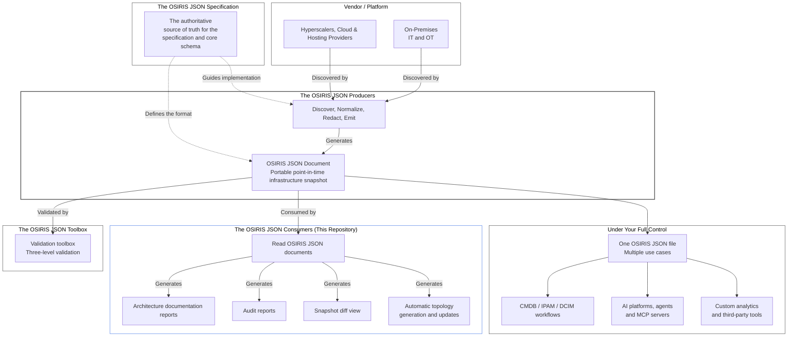

# The OSIRIS JSON Consumers

[OSIRIS JSON](https://github.com/osirisjson/osiris) is an Open
Specification for Infrastructure Resource Interchange Schema that
defines a vendor-neutral JSON format for describing infrastructure
resources, their properties and their topological relationships across
heterogeneous IT and OT environments.

An [OSIRIS JSON Producer](https://github.com/osirisjson/osiris-producers)
connects to a vendor applicance or platform and emits a vendor-neutral
portable OSIRIS JSON document.
OSIRIS JSON Consumers (this repository) read that document and generate:

1. a Markdown/PDF brief and inventory that represents every resource,
   connection, group, provider, and unknown type in the document without
   semantic loss with a companion XLSX file if reports generate tables
   over 50 rows.
2. a draw.io topology that represents the complete graph with generic
   fallback nodes and literal edges.

### Architecture workflow

### Installation

See the official guidelines available on [docs.osirisjson.org/osiris-consumers/installation](https://docs.osirisjson.org/osiris-consumers/installation/)

### Documentation and contribution

See `CONTRIBUTING.md`. Contributions target the `dev` branch as small,
reviewable increments. `main` carries tagged releases only.

- [Community & contribution guidelines](https://docs.osirisjson.org/community/contributing/)