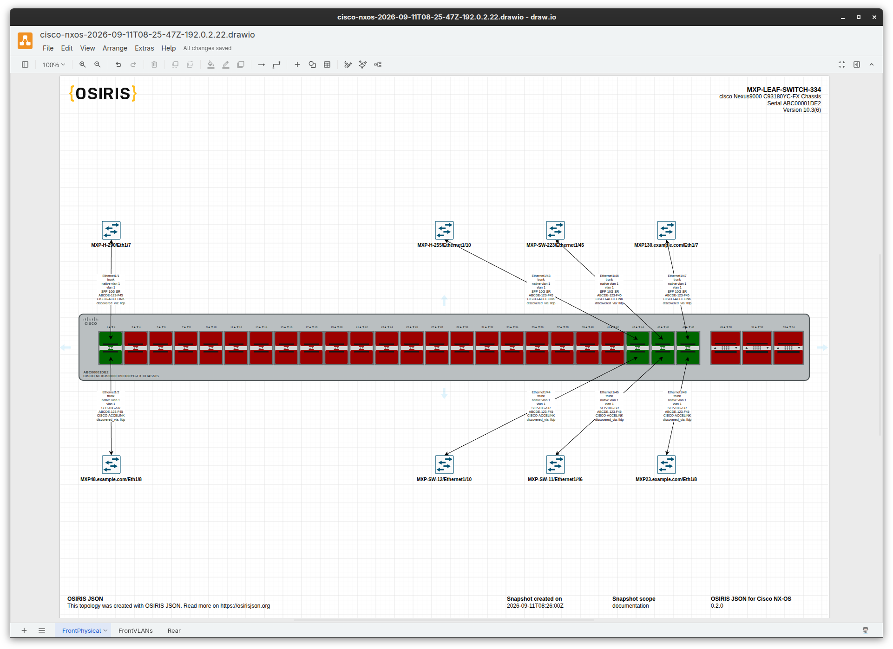
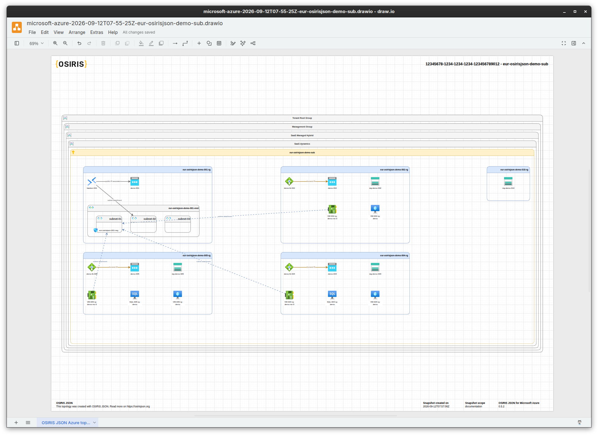
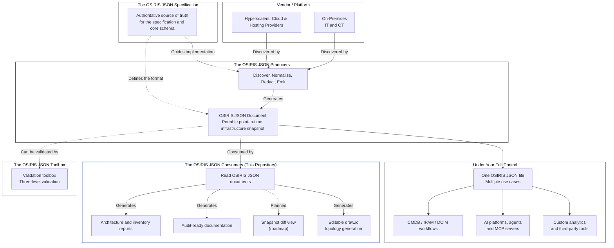

# The OSIRIS JSON Consumers

Turn [OSIRIS JSON](https://github.com/osirisjson/osiris) portable
infrastructure snapshots into documentation, inventory reports, and
editable [draw.io](https://www.drawio.com/) diagrams without AI or any
license or vendor-specific applications.

[OSIRIS JSON](https://github.com/osirisjson/osiris) is an Open
Specification for Infrastructure Resource Interchange Schema.
It defines a vendor-neutral JSON Schema format for describing
infrastructure resources, their properties, provider provenance, groups
and topology relationships across heterogeneous IT and OT environments.

[OSIRIS JSON Producers](https://github.com/osirisjson/osiris-producers)
discover infrastructure from vendor platforms or devices and generate
portable, point-in-time OSIRIS JSON documents. **OSIRIS JSON Consumers**
(this repository) read those documents and turn them into useful,
human-readable and editable outputs.

## What OSIRIS JSON Consumers generate

1. **Infrastructure documentation and inventory:** Markdown and PDF
   reports covering resources, connections, groups, and provider
   attribution. Unknown resource and relationship types are handled
   generically rather than silently discarded. When report tables exceed
   50 rows, a companion XLSX workbook is automatically generated.
2. **Editable infrastructure topology:** draw.io diagrams built from the
   document's explicit resources and connections, with generic fallback
   nodes for unrecognized types. The source document remains the
   authoritative record; the diagram is a visualization of its contents.

These outputs are based on the OSIRIS JSON snapshot document.
OSIRIS JSON Consumers once installed works completely offline and never
require anything else to generate them.
In accordance with the OSIRIS JSON specification, Consumers MUST perform
structural validation (or equivalent checks) before processing documents
and handle unrecognized types without silently dropping resources.

### Examples

#### A Cisco Nexus 9000  draw.io topology

*Example of a [draw.io](https://www.drawio.com/) topology auto-generated from an OSIRIS JSON snapshot of a Cisco Nexus 9000 device.*

#### A Microsoft Azure draw.io topology

*Example of a [draw.io](https://www.drawio.com/) topology auto-generated from an OSIRIS JSON snapshot of a Microsoft Azure Subscription.*

### Architecture workflow

## Installation and getting started

See the [OSIRIS JSON Consumers getting-started guide](https://docs.osirisjson.org/osiris-consumers/getting-started/)
for the project overview, installation guide and other informations.

## Documentation and contributing

Contributions are welcome. Please read [`CONTRIBUTING.md`](CONTRIBUTING.md)
and the [community contribution guidelines](https://docs.osirisjson.org/community/contributing/)
before opening a pull request.

Contributions target the `dev` branch as small, reviewable increments.
The `main` branch will contains only tagged releases.

## License

Licensed under the [Apache License 2.0](LICENSE).